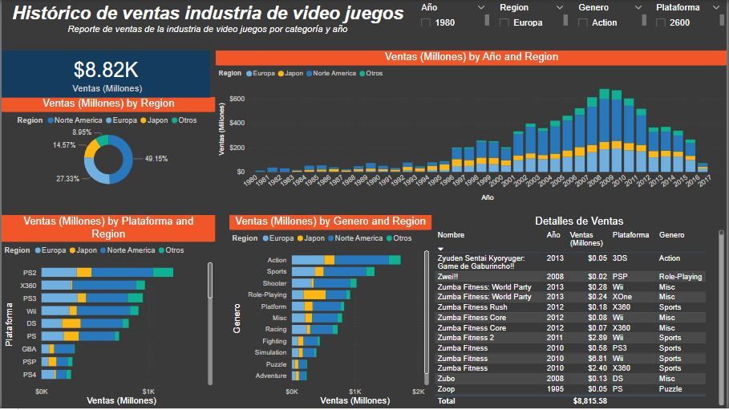

# Video Games Industry Sales Dashboard (Power BI)

Interactive **Power BI** report on the historical sales of the video game industry (1980–2016), broken down by year, region, platform and genre.

**Stack:** Power BI Desktop · Power Query · DAX · Data modeling

<p align="center">
  
</p>

---

## What the report shows

- **Total sales KPI:** about 8.82K million in sales across the full period.
- **Sales by region (donut):** North America 49.15%, Europe 27.33%, Japan 14.57%, other regions 8.95%.
- **Sales by year and region (stacked columns):** growth from the 1980s to a peak around 2008, then a decline.
- **Sales by platform and region:** PS2, Xbox 360, PS3 and Wii lead the ranking.
- **Sales by genre and region:** Action, Sports and Shooter are the top genres.
- **Detail table:** game, year, sales, platform and genre, with totals.
- **Slicers** for year, region, genre and platform to explore the data interactively.

## How it was built

1. Imported the sales dataset into Power BI and cleaned it in **Power Query** (data types, regional sales columns).
2. Built the data model and **DAX** measures for total and regional sales.
3. Designed a one-page report with KPI card, donut, stacked column and bar charts, a detail table and slicers.

## Files

```
├── Power-Bi-Project-Video-Games-Industry.pbix   -- Power BI report (open with Power BI Desktop)
└── Power-Bi-Project-Video-Games-Industry.JPG    -- dashboard screenshot
```

---

**Stanly Fernández** · [LinkedIn](https://www.linkedin.com/in/stanly-fernandez/) · [Portfolio](https://stanly06.github.io/) · [GitHub](https://github.com/Stanly06)
